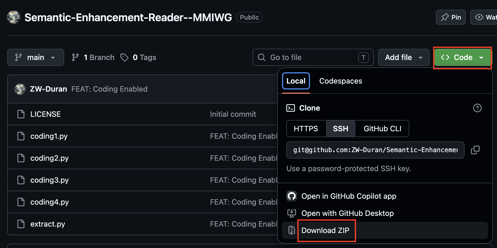
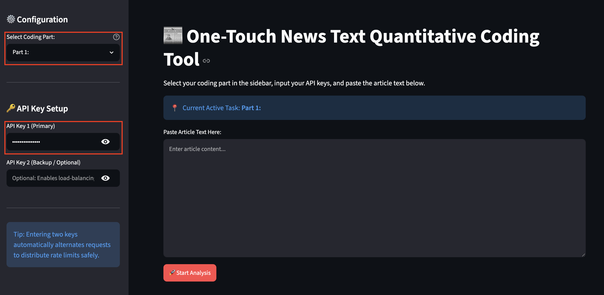

# **One-Touch News Text Quantitative Coding Tool**
https://github.com/ZW-Duran/Semantic-Enhancement-Reader--MMIWG
Oct. 14th, 2026

A lightweight, secure, and user-friendly Streamlit-based web application designed for researchers to perform structured quantitative coding of US newspaper archives using Google AI Studio.

## Introduction
Welcome! This tool helps our research team perform structured quantitative coding of newspaper archives using Google AI Studio. 

⚠️ **Safe & Isolated**: This tool runs inside an isolated local sandbox. It **will not** affect or modify any existing Python environments, software, or files on your computer.

---

## 🛠️ Step 1: Download the Project (No Git Required!)
1. Scroll to the top of this GitHub page.
2. Click the green **`< > Code`** button.
3. Click **`Download ZIP`**.
4. Once downloaded, **unzip/extract** the folder to your desktop or documents folder.

---

## ⚙️ Step 2: One-Time Environment Setup (Do this only ONCE)
> **<mark> *For BOTH WIN&MAC Users:* You may be asked to install Python first. Please follow these quick steps to install Python: </mark>**
```markdown
1. Visit the official Python downloads page: https://www.python.org/downloads/
2. Download and run the latest Python 3.13 installer.
3. [CRITICAL] At the bottom of the installer window, make sure to check:
   [√] Add python.exe to PATH
4. Click "Install Now" to complete the setup.

After installation, please re-double-click the coresponding install program.
```

### For Windows Users:
1. Open the extracted folder.
2. Double-click the file named **`install_win.bat`**.
3. *Note:* A black command window will open, automatically configure a safe sandbox, and install the required tools. Wait for it to say `[SUCCESS] Installation complete!` and press any key to close.

### For macOS Users:
1. Open the extracted folder.
2. **Right-click** (or Control-click) on **`install_mac.command`** and select **Open** (this bypasses Apple's security check for the first time).
3. A terminal window will open and automatically install the required tools.
---

## 🚀 Step 3: Running the Coding Apps

After running the one-time installer, you can launch the app anytime with a single double-click:

* Windows: Double-click coding_win.bat

* Mac: Double-click coding_mac.command

(A local browser window will automatically open to the app interface).

---

## 💡 How to Use the Tool

1. Select Coding Part: In the sidebar, choose the specific coding module (Part 1 to 4) you are working on from the dropdown menu.

2. Configure API Keys: [Check [Google Offical Documents](https://ai.google.dev/gemini-api/docs/api-key)  or [How to Creaet API Keys from Google AI Studio](https://www.z1w.net/how-to-create-api-keys-from-google-ai-studio/) for help.]

    * Enter your primary Google AI Studio API Key 1.

    * (Optional) Enter API Key 2 to enable automatic dual-channel load-balancing and avoid rate limits.

3. Input Text: Paste the newspaper article text into the main text area.

4. Run Analysis: Click 🚀 Start Analysis to get structured JSON outputs and evidence.

5. Copy and paste the results in the corresponding spreadsheet.

---

## 🔄 How to Get Future Updates
When our team updates the prompts or code:
1. Go back to this GitHub page.
2. Click **`Download ZIP`** again to get the latest version.
3. Replace your old folder with the new one (or just replace the updated `.py` files).
> If there's a main update, delete your previous folder (including the .venv). Download the latest ZIP File and re-run the install script.

