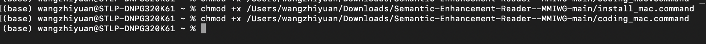

# **One-Touch News Text Quantitative Coding Tool**
https://github.com/ZW-Duran/Semantic-Enhancement-Reader--MMIWG

Oct. 14th, 2026

A lightweight, secure, and user-friendly Streamlit-based web application designed for researchers to perform structured quantitative coding of US newspaper archives using Google AI Studio. 

[Demo](https://mmiwg.z1w.net)

## Introduction
Welcome! This tool helps our research team perform structured quantitative coding of newspaper archives using Google AI Studio. 

⚠️ **Safe & Isolated**: This tool runs inside an isolated local sandbox. It **will not** affect or modify any existing Python environments, software, or files on your computer.

---

## 🛠️ Step 1: Download the Project (No Git Required!)
1. Scroll to the top of this GitHub page.
2. Click the green **`< > Code`** button.
3. Click **`Download ZIP`**.
4. Once downloaded, **unzip/extract** the folder to your desktop or documents folder.

---

## ⚙️ Step 2: One-Time Environment Setup (Do this only ONCE)
> **<mark> *For BOTH WIN&MAC Users:* You may be asked to install Python first. Please follow these quick steps to install Python if required: </mark>**
```markdown


After installation, please re-double-click the coresponding install program.
```

### For Windows Users:
1. Open the extracted folder.
5. Double-click the file named **`install_win.bat`**.
6. *Note:* A black command window will open, automatically configure a safe sandbox, and install the required tools. Wait for it to say `[SUCCESS] Installation complete!` and press any key to close.
> If you've been ask to install python. Open your `Powershell`. Type in the following and press Enter:
```bash
winget install Python.Python.3.13 --silent --accept-package-agreements --accept-source-agreements
```

### For macOS Users:
> If you've been ask to install python. Open your `Terminal`. Type in the following and press Enter:
```bash
/bin/bash -c "$(curl -fsSL https://raw.githubusercontent.com/Homebrew/install/HEAD/install.sh)" && brew install python@3.13
```
1. Open the extracted folder.
2. Open "Terminal" (you could use `command+space` to search for it)
3. Type: (remember there's a `space` at the end of the `x`)
```bash
chmox +x 
```
4. Then drag `install_mac.command` into the terminal. [See photo below:]

5. Once you have everything ready, hit `Return` bottom on your keyboard. [There won't be anything printed out]
6. Do Step 3 to 5 again but this time drag `coding_mac.command`.
7. Double-Click **`install_mac.command`**. A terminal window will open and automatically install the required tools. 
8. After it says `Press Return to close this window...`, press `Return` on your keyboard and close this terminal window.
---

## 🚀 Step 3: Running the Coding Apps

After running the one-time installer, you can launch the app anytime with a single double-click:

* Windows: Double-click `coding_win.bat`

* Mac: Double-click `coding_mac.command`

> For the first time, it might ask you for your email. Leave it empty and hit `enter/return` to skip. While you are using the program, please don't close the terminal Window.

(A local browser window will automatically open to the app interface).

---

## 💡 How to Use the Tool

1. Select Coding Part: In the sidebar, choose the specific coding module (Part 1 to 4) you are working on from the dropdown menu.

2. Configure API Keys: [Check [Google Offical Documents](https://ai.google.dev/gemini-api/docs/api-key)  or [How to Creaet API Keys from Google AI Studio](https://www.z1w.net/how-to-create-api-keys-from-google-ai-studio/) for help.]

    * Enter your primary Google AI Studio API Key 1.

    * (Optional) Enter API Key 2 to enable automatic dual-channel load-balancing and avoid rate limits.

3. Input Text: Paste the newspaper article text into the main text area.

4. Run Analysis: Click 🚀 Start Analysis to get structured JSON outputs and evidence.

5. Copy and paste the results in the corresponding spreadsheet.

---

## 🔄 How to Get Future Updates
When our team updates the prompts or code:
1. Go back to this GitHub page.
2. Click **`Download ZIP`** again to get the latest version.
3. Replace your old folder with the new one (or just replace the updated `.py` files).
> If there's a main update, delete your previous folder (including the .venv). Download the latest ZIP File and re-run the install script.
